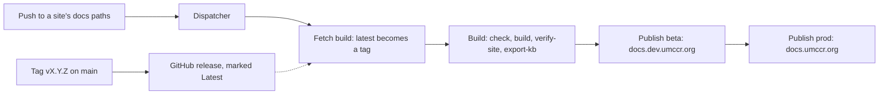

# Product

docs-toolkit is `umccr-docs`, the Python toolkit that checks, builds, exports and publishes every documentation site on
[docs.umccr.org](https://docs.umccr.org), and the theme those sites share. This page covers what it does, who uses it,
where it stands and what is open. [Structure](structure.md) covers its layout and resources, [Tech stack](tech.md) its
technology, and the [Runbook](runbook.md) how to change and release it.

## What it is

Each UMCCR team writes its site in its own repository, and [umccr/docs-platform](https://github.com/umccr/docs-platform)
publishes it at `https://docs.umccr.org/<slug>/` behind UMCCR sign-in. The toolkit is the step in between. It checks a
site's `mkdocs.yml` and Markdown, or an Obsidian vault, builds a strict Material for MkDocs site with the UMCCR theme,
checks the built site, exports the pages for the chat panel, and uploads the site.

Every site gets the same theme, Markdown extensions and script. No site can bring code of its own: all sites share one
browser origin, where the sign-in page keeps the reader's tokens, so a script on one page could act as the reader on
every site.

| Fact | Value |
| --- | --- |
| Repository | [umccr/docs-toolkit](https://github.com/umccr/docs-toolkit), public, MIT licence |
| Package and command | `umccr-docs`, module `umccr_docs`, version `0.3.2` |
| Latest release | `v0.3.2`, made on 2026-11-18 |
| Distribution | git tags with immutable GitHub releases; not on PyPI |
| Runtime | Python 3.11 or later; the pins are resolved for 3.12 |
| Engine | Material for MkDocs `9.7.7` on MkDocs `1.6.1` |
| Sites, on 2026-11-19 | `/platform/`, `/management-knowledgebase/` and `/orcasonar/`, all following the latest release |
| Owner | the UMCCR platform team |

## Who uses it

| Who | How |
| --- | --- |
| Site owners | run `check`, `build` and `serve` in their repository to preview a site as the pipeline builds it ([Onboarding](https://github.com/umccr/docs-platform/blob/main/docs/site/onboarding.md)) |
| The site pipeline | `UMCCR-DocsSitesPipeline` in docs-platform runs `check`, `build`, `verify-site` and `export-kb` with no write access, then `publish` in each stage |
| docs-platform's CI | builds `/platform/` with the latest release on every pull request |
| Readers | see the theme: navigation, the catalogue, the account menu, search, the chat panel and diagrams |
| OrcaSonar | indexes the documents `export-kb` writes, to answer in the chat panel |
| The platform team | maintains and releases the toolkit, and moves sites between releases |

## What it does

| Command | Does |
| --- | --- |
| `umccr-docs check` | checks `mkdocs.yml` and the pages against the contract |
| `umccr-docs build` | checks, preprocesses and builds strictly into `site/` |
| `umccr-docs serve` | the same build on `http://127.0.0.1:8000`, rebuilt as pages change |
| `umccr-docs verify-site <dir>` | checks a built site before it is published |
| `umccr-docs export-kb` | writes each page as a document with metadata, for OrcaSonar |
| `umccr-docs publish <dir>` | uploads a site and its documents; the site pipeline runs it |
| `umccr-docs preprocess` | writes only the preprocessed pages, for debugging |

- **The contract.** `mkdocs.yml` may set only content keys such as `site_name`, `nav`, `docs_dir` and `extra`; the
  platform owns `theme`, `markdown_extensions`, `extra_javascript` and the rest. `site_url` must be
  `https://docs.umccr.org/<slug>/`, and plugins are limited to `search` and `tags`. Pages, front matter, configuration
  values and HTML, SVG or XML files may not hold `<script>`, event handlers, frames, `<base>` or `javascript:` URLs.
  Pages are checked as rendered, and HTML inside code passes. Authors read the rules in docs-platform's
  [Authoring](https://github.com/umccr/docs-platform/blob/main/docs/site/authoring.md) page, and
  [Checks and errors](checks.md) lists every message.
- **Preprocessing.** The build copies the files under `docs_dir` that git would commit into `.umccr-docs/`, rewrites
  links that leave `docs_dir` to the file on GitHub, and publishes a home note (`extra.platform.home`) as `index.md`.
- **Obsidian vaults.** With `extra.platform.source_format: obsidian`, the build turns wikilinks, callouts, comments,
  and the queries in ```` ```base ```` and ```` ```tasks ```` blocks into plain Markdown, and shows chosen front matter
  as a properties card. Syntax outside the supported subset, such as embeds, block references or Dataview, stops the
  build with the note and line. A link to a missing note only warns.
- **Pre-publish checks.** `verify-site` requires `index.html`, `404.html` and the theme's files, and refuses hidden
  files, symlinks, source maps, key files, oversized files, text that looks like a credential, and code that could run.
- **Documents for the chat.** `export-kb` writes each published page as Markdown with absolute links, beside a
  `.metadata.json` in the Bedrock knowledge base format: `doc_id`, `site`, `title`, `url`, `commit` and `updated`.
- **Safe publishing.** `publish` narrows the stage's `docs-publisher` role to the site's own prefixes, skips a site
  release older than the live one, uploads before it deletes, writes its marker last, and refuses to delete most of a
  site by mistake.
- **The theme.** Navigation and breadcrumbs, each page's date and GitHub link, code blocks, callouts, Mermaid
  diagrams, the catalogue, the account menu and the chat panel, the same on every site.

## How docs.umccr.org uses it



Each site's entry in docs-platform's registry has a `toolkitRef`: `latest`, unless it pins a tag or a commit. When a
push starts a site release, the fetch build turns `latest` into the latest release's tag, and every step of the site
pipeline installs that release. A toolkit release therefore reaches every unpinned site at its next push, with no
change in docs-platform
([ADR-0011](https://github.com/umccr/docs-platform/blob/main/docs/design/adr/0011-latest-toolkit-release.md)).
[Structure](structure.md#how-docs-platform-runs-the-toolkit) has the commands each step runs.

## Principles

1. **Sites cannot run code.** The contract and `verify-site` keep scripts out of every page, so a change to them is a
   security change.
2. **The rendered page decides.** Checks run on pages as the engine renders them, after preprocessing.
3. **Strict by default.** A warning fails the build, and unsupported syntax is reported rather than rendered wrongly.
4. **Building never holds publishing rights.** The build cannot write, and a publish is narrowed to one site.
5. **The live site only moves forward.** An older site release never replaces a newer one.
6. **Everything is pinned.** Dependencies by hash, hooks and actions by commit, Mermaid by version.
7. **A release reaches the sites.** Review and the release are the last gate, so breaking changes go out as
   pre-releases first.
8. **The repository is public.** It never holds credentials or private content
   ([SECURITY.md](https://github.com/umccr/docs-toolkit/blob/main/SECURITY.md)).

## Limits

- Hosting, sign-in and the pipelines belong to docs-platform, and the chat's answers to OrcaSonar.
- docs.umccr.org's origin, slug rules, theme, S3 layout, SSM parameters and publisher role are built in.
- Mermaid diagrams are drawn in the reader's browser, so no check catches a broken one.
- MkDocs plugins other than `search` and `tags` are not allowed.

## Where it stands, on 2026-11-19

| Date | Milestone |
| --- | --- |
| 2026-10-21 | `v0.1.0`, the first release, tagged in docs-platform; `v0.1.1` put the theme's script back in the package |
| 2026-10-28 | `v0.2.0`, a new look for every site; `v0.2.1`, bare URLs as links and Tasks queries as lists |
| 2026-11-04 | `v0.3.0`, a GitHub link under each title and Mermaid diagrams; `v0.3.1`, a link-rewriting fix |
| 2026-11-11 | moved to umccr/docs-toolkit with its history and its tags from `v0.2.0` ([ADR-0010](https://github.com/umccr/docs-platform/blob/main/docs/design/adr/0010-toolkit-repository.md)) |
| 2026-11-18 | `v0.3.2`, the first release from here; sites follow the latest release |

Release notes from `v0.3.2` are in [CHANGELOG.md](https://github.com/umccr/docs-toolkit/blob/main/CHANGELOG.md), and
earlier ones in docs-platform's [changelog](https://github.com/umccr/docs-platform/blob/main/docs/site/changelog.md).

## Open items

| Open item | Decided in |
| --- | --- |
| The engine: Material for MkDocs on MkDocs 1.6, or Zensical | [ADR-0003](https://github.com/umccr/docs-platform/blob/main/docs/design/adr/0003-build-engine.md) |
| A UMCCR profile that gathers the docs.umccr.org values, so others could use the toolkit; `boto3` as an optional extra | [ADR-0010](https://github.com/umccr/docs-platform/blob/main/docs/design/adr/0010-toolkit-repository.md) |
| Rulesets: `main` requires no approval or checks yet, and nothing protects `v*` tags | [Repository settings](runbook.md#repository-settings) |
| GitHub releases for the carried-over tags `v0.2.0` to `v0.3.1`, needed before rolling back to one | [Roll back a release](runbook.md#roll-back-a-release) |
| `v1.0.0`, once the engine is decided and a team outside the platform depends on the contract | [Versioning](runbook.md#versioning) |

## Vocabulary

| Term | Meaning |
| --- | --- |
| site, slug | one docs.umccr.org site, served at `/<slug>/` and stored under `sites/<slug>/`. A slug is lowercase letters, digits and inner hyphens, at most 49 characters; `sites` is reserved |
| contract | what a site's `mkdocs.yml`, pages and files may contain |
| work directory | `.umccr-docs/` beside `mkdocs.yml`: the preprocessed pages, the theme and the effective configuration |
| effective configuration | the `mkdocs.yml` the engine builds with: the site's keys merged with the platform's |
| strict build | a build that fails on any engine warning, such as a broken link |
| documents | the pages as Markdown, each with a `.metadata.json` file, for OrcaSonar |
| marker | `sites/<slug>/_publish.json`, which `publish` writes last, recording the site release |
| toolkit release | a `vX.Y.Z` tag on `main` and the GitHub release made for it |
| latest release | the GitHub release marked Latest: the highest released version |
| pre-release | a toolkit release whose tag has a suffix, such as `v0.4.0-rc.1`; never latest |
| site release | one numbered build and publish of one site by the site pipeline |
| toolkit ref, pin | the toolkit release a site builds with, its `toolkitRef`: `latest`, or a pinned tag or commit |
| registry | `DOCS_SITES` in docs-platform's `infrastructure/sites.ts` |
| fetch build | docs-platform's CodeBuild project that clones a site's commit and resolves `latest` |
| `docs-publisher` | each stage's publishing role, narrowed to one site per publish |
| home note | the page `extra.platform.home` names, published as the site's `index.md` |
