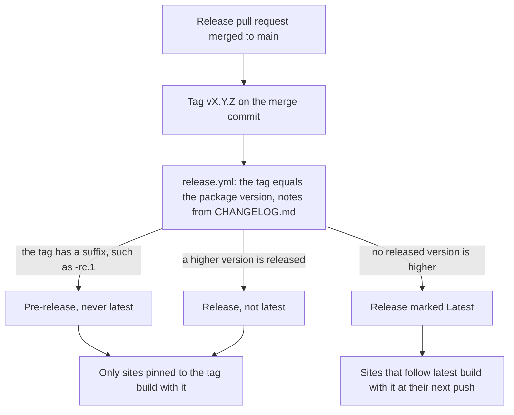

# Runbook

How to develop, update, release and roll back docs-toolkit. The toolkit has no infrastructure to deploy: a release is
how a change reaches the sites. Site-side procedures, such as starting a site release by hand, are in docs-platform's
[runbook](https://github.com/umccr/docs-platform/blob/main/docs/site/runbook.md#toolkit-releases). This page is
`docs/runbook.md` in the repository, so it can be read on GitHub when docs.umccr.org is down.

## Prerequisites

Python 3.12, Node.js 22 or later, [pre-commit](https://pre-commit.com), [uv](https://docs.astral.sh/uv/) for the pins,
and the GitHub CLI signed in with `gh auth login`. Only the platform owners create `v*` tags.

## Develop

```sh
git clone https://github.com/umccr/docs-toolkit.git && cd docs-toolkit
make install                       # .venv: the engine, the dev tools and the toolkit (editable); the git hook
git switch -c fix/<what-it-fixes>  # the history uses feat/, fix/, docs/ and release/ branches
make fix && make check && make test && make sites
```

Describe changes that sites will notice under `## Unreleased` in `CHANGELOG.md`. In the pull request, say if it is a
security change (the contract, the scanner, `verify-site`, content types or the theme's script) or needs sites to
change. Merge once CI's four checks pass and it is reviewed. A merge changes how no site is built: sites move only with
a release.

## Preview a change

```sh
make serve                                              # the basic example, on http://127.0.0.1:8000
make serve CONFIG=examples/obsidian-vault/mkdocs.yml    # the example vault
cd ../docs-platform && ../docs-toolkit/.venv/bin/umccr-docs serve   # a real site, with this checkout
```

Check a theme change on the basic example's Components page, in both colour schemes. The editable install cannot show
a file the package leaves out, so after a change to the theme's files or to packaging, build from the wheel as CI does:

```sh
python3.12 -m venv /tmp/toolkit-wheel
/tmp/toolkit-wheel/bin/pip install --require-hashes --no-deps -r requirements/build.txt
/tmp/toolkit-wheel/bin/pip install --no-deps .
/tmp/toolkit-wheel/bin/umccr-docs build --config examples/basic-site/mkdocs.yml --site-dir /tmp/basic-site
/tmp/toolkit-wheel/bin/umccr-docs verify-site /tmp/basic-site
```

## Update pinned dependencies

- **Engine and runtime:** edit `requirements/build.in` and regenerate `requirements/build.txt`. A new engine version
  can change every site's pages, so preview a real site with it.
- **pytest and ruff:** the same, with `requirements/dev.in`; `zensical.in` likewise for the engine comparison.
- **pre-commit hooks:** `pre-commit autoupdate --freeze`, then `make check`. pre-commit itself is pinned in `ci.yml`.
- **GitHub Actions:** change the commit and its version comment together; the first command below finds the commit.

```sh
uv pip compile --generate-hashes --python-version 3.12 --universal requirements/build.in -o requirements/build.txt
uv pip compile --generate-hashes --python-version 3.12 --universal requirements/dev.in -o requirements/dev.txt
curl -fsS https://api.github.com/repos/actions/checkout/commits/v7.0.1 | python3 -c \
  'import json, sys; print(json.load(sys.stdin)["sha"])'
```

**Mermaid:** the theme's copy is npm's `dist/mermaid.min.js` and `LICENSE`, byte for byte. Take the newest `mermaid@11`
release (what Material `9.7.7` asks for) that is at least two weeks old, and check the tarball against the registry's
integrity hash before copying the files in:

```sh
VERSION=11.17.2
curl -fsS https://registry.npmjs.org/mermaid | VERSION=$VERSION python3 -c \
  'import json, os, sys; print("published", json.load(sys.stdin)["time"][os.environ["VERSION"]])'
curl -fsS "https://registry.npmjs.org/mermaid/$VERSION" | python3 -c \
  'import json, sys; print(json.load(sys.stdin)["dist"]["integrity"])'
curl -fsSL -o /tmp/mermaid.tgz "https://registry.npmjs.org/mermaid/-/mermaid-$VERSION.tgz"
echo "sha512-$(openssl dgst -sha512 -binary /tmp/mermaid.tgz | openssl base64 -A)"   # must equal the line above
tar -xzf /tmp/mermaid.tgz -C /tmp
cp /tmp/package/dist/mermaid.min.js src/umccr_docs/theme/assets/umccr/mermaid/mermaid.min.js
cp /tmp/package/LICENSE src/umccr_docs/theme/assets/umccr/mermaid/LICENSE.txt
```

Then update its version in `CONTRIBUTING.md`, `CHANGELOG.md` and [The stack](tech.md#the-stack), and check each kind of
diagram the sites use, in both colour schemes, locally and then in dev.

## Release

### 1. Prepare

Until `v1.0.0`, a change that could break a site takes the next minor version, `v0.4.0`, with a migration note; fixes
and compatible additions take the next patch, `v0.3.3`. On a branch `release/v0.4.0`:

| File | Change |
| --- | --- |
| `pyproject.toml`, `src/umccr_docs/__init__.py` | the version, `0.4.0`, in both; a test compares them |
| `CHANGELOG.md` | `## Unreleased` becomes `## v0.4.0`, opening with what changes for sites; it becomes the release notes |

Run `make check`, `make test` and `make sites`, and open the pull request `Release v0.4.0`.

### 2. Merge and tag

```sh
git switch main && git pull --ff-only
git log -1 --oneline                  # the release pull request's merge commit
git tag -s v0.4.0 -m "v0.4.0"         # -a instead of -s without a signing key
git push origin v0.4.0
```

### 3. Check the release

The release workflow checks the tag against the package version, takes the notes from `CHANGELOG.md`, and creates the
GitHub release, marked Latest when no released version is higher:

```sh
gh release view v0.4.0 --repo umccr/docs-toolkit
curl -fsS -o /dev/null -w '%{redirect_url}\n' https://github.com/umccr/docs-toolkit/releases/latest   # ends in v0.4.0
```

### 4. Follow the sites

Nothing merges in docs-platform. Its CI builds `/platform/` with the release on its next run, and its "Strict build of
the platform site" job names the release: a red build there is the first sign of trouble. Each unpinned site builds
with the release at its next push. To move a site sooner, start a site release by hand with the tag
([Rebuild the sites that should not wait](https://github.com/umccr/docs-platform/blob/main/docs/site/runbook.md#rebuild-the-sites-that-should-not-wait)).
A run's `TOOLKIT_REF` and its Build log line `umccr-docs <version>` show which release built a site; neither the
marker nor the footer does.

## The tag system



### Tag names

| Tag | Is | Package version |
| --- | --- | --- |
| `vX.Y.Z`, such as `v0.3.2` | a release, Latest when no released version is higher | `0.3.2` |
| `vX.Y.Z-<suffix>`, such as `v0.4.0-rc.1` | a pre-release, never latest | `0.4.0-rc.1` |

- The tag is `v` and the version in `pyproject.toml`, and `CHANGELOG.md` has a `## <tag>` section; the release
  workflow refuses anything else.
- A suffix uses only letters, digits and dots, the only form docs-platform accepts.
- Tags go on the release's merge commit on `main`, annotated or signed, and are never moved or deleted.

### Tags so far

| Tag | Tagged | Notes |
| --- | --- | --- |
| `v0.1.0` to `v0.1.2` | 2026-10-21 to 2026-10-27 | in docs-platform only; no site uses them |
| `v0.2.0`, `v0.2.1` | 2026-10-28 | carried over from docs-platform; `v0.2.1`'s package still reads `0.2.0` |
| `v0.3.0`, `v0.3.1` | 2026-11-04 | carried over from docs-platform |
| `v0.3.2` | 2026-11-18 | the first from here, and on 2026-11-19 the only GitHub release: immutable, and the latest |

Each carried-over tag holds exactly what `toolkit/` held at that tag in docs-platform, so sites can roll back to it.
The tags so far are annotated; none is signed.

### Which release is latest

The release workflow compares a new version with the current latest (`sort -V`) and marks it Latest only when it is
higher, so a patch to an older line, such as `v0.3.3` after `v0.4.0`, leaves the sites alone. A tag with a suffix
becomes a pre-release. A release made by hand takes `--latest=false` unless it is the highest version, because GitHub
otherwise marks every new release Latest.

### How a site chooses its release

| `toolkitRef` in docs-platform's `infrastructure/sites.ts` | The site builds with |
| --- | --- |
| `latest`, the default (`DOCS_TOOLKIT_REF`) | the latest release when each site release starts |
| a release tag or a full commit | that release, until the entry changes |
| a branch | nothing: the registry refuses it |

The fetch build resolves `latest` once per site release, by following `releases/latest` to a `vX.Y.Z` tag. Every step
of the run, and any retry, installs that tag; the site pipeline refuses a `TOOLKIT_REF` that is not a tag or a commit.

### What protects a tag

| Protection | On 2026-11-19 |
| --- | --- |
| A `v*` tag ruleset: only the platform owners create tags, and nobody updates or deletes them | not created yet |
| Release immutability: each release locks its tag to its commit | on: `v0.3.2` is immutable |
| The release workflow's version and changelog checks | in place |
| Review on `main`: one approval and the `ci` checks | a pull request is required; approval and checks are not yet |

### Versioning

Releases are semantic versions, and the package version is the tag without its `v`. Until `v1.0.0`, a breaking change
takes the next minor version and a migration note. `v1.0.0` comes once the engine is decided, the first users'
feedback is in, and a team outside the platform depends on the contract; from then on, a breaking change takes a new
major version.

## Try a release on one site first

1. Set the version to `0.4.0-rc.1` in both files, add a `## v0.4.0-rc.1` section to `CHANGELOG.md`, merge, and tag
   `v0.4.0-rc.1`. It becomes a pre-release, which no unpinned site builds with.
2. Move one site to it. Either pin it, with `toolkitRef: 'v0.4.0-rc.1'` in docs-platform
   ([Pin a site to a release](https://github.com/umccr/docs-platform/blob/main/docs/site/runbook.md#pin-a-site-to-a-release)),
   or start one site release by hand with that `TOOLKIT_REF` and `STAGES` `beta`, which lasts until the site's next
   push ([Start a release by hand](https://github.com/umccr/docs-platform/blob/main/docs/site/runbook.md#start-a-release-by-hand)).
3. Check the site in dev, then in prod
   ([Check](https://github.com/umccr/docs-platform/blob/main/docs/site/runbook.md#check)). Then release `v0.4.0` as
   usual and remove the pin.

## Roll back a release

A release that cannot build a site stops at Build, and the live site stays as it was. For one that builds but
publishes something wrong:

| To | Do | Takes effect |
| --- | --- | --- |
| move every unpinned site back | mark the previous release Latest | at each site's next push |
| hold one site back | pin it in docs-platform's registry | after pipeline 1's self-update |
| rebuild a site now | start a site release by hand with the previous tag | within minutes |

```sh
gh release edit v0.3.2 --repo umccr/docs-toolkit --latest   # for example, back from v0.4.0 to v0.3.2
```

Only `v0.3.2` has a GitHub release on 2026-11-19, so an earlier tag needs its release made first:

```sh
gh release create v0.3.1 --repo umccr/docs-toolkit --verify-tag --title v0.3.1 --latest \
  --notes "Notes: https://github.com/umccr/docs-platform/blob/main/docs/site/changelog.md#v031"
```

Retrying an old site release does not help: it keeps its `TOOLKIT_REF`, and is skipped when a newer site release is
live. Fix the cause on `main` and release the next patch.

## The release workflow refused a tag

| The log says | Do |
| --- | --- |
| `Tag vX.Y.Z does not match the package version in pyproject.toml, A.B.C` | fix the version on `main`, and release the next patch |
| `CHANGELOG.md has no '## vX.Y.Z' section to take the release notes from` | add the section, and release the next patch |
| `Could not read the latest release: ...` | re-run it with `gh run rerun <run-id> --repo umccr/docs-toolkit --failed`; nothing was created |

A refused tag has no release, so no unpinned site uses it. Leave it in place, and never pin a site to it.

## Publish a site by hand

Only in an emergency, with a stage's admin credentials, following docs-platform's
[Publishing by hand](https://github.com/umccr/docs-platform/blob/main/docs/site/deploy.md#publishing-by-hand).
Without `--role-arn` nothing narrows the publish to one site: check `--slug`, run with `--dry-run` first, build from a
clean `git archive` of the commit, and never publish while the pipeline is publishing the same site.

## Update these pages

The pages are `docs/*.md`, in the order `mkdocs.yml` gives them in `nav`, where `product.md`, the front page, appears
as `index.md`. Check a change from the repository root:

```sh
.venv/bin/umccr-docs check && .venv/bin/umccr-docs build --site-dir /tmp/docs-toolkit-site
.venv/bin/umccr-docs verify-site /tmp/docs-toolkit-site
.venv/bin/umccr-docs serve
```

Once the pages are registered as a site, a merge that changes `docs/` or `mkdocs.yml` publishes them, built with the
latest release. People read them, and the chat panel quotes them out of context, so:

- open each page with what it covers, and give each heading a subject that stands on its own;
- name things instead of writing "it" or "above", use the [Vocabulary](product.md#vocabulary), and write "toolkit
  release" or "site release" wherever "release" alone could mean either;
- put facts in tables, and date whatever will change;
- give every Mermaid diagram the same facts in text;
- link pages with relative `.md` links, and other files with full GitHub URLs;
- change [Checks and errors](checks.md) in the same pull request as a message.

## Repository settings

These guard every unpinned site, and an organisation owner sets them:

| Setting | Should be | On 2026-11-19 |
| --- | --- | --- |
| `main` ruleset | a pull request with one approval and the four `ci` checks; no force pushes or deletion | `protect-main`: a pull request, no force pushes or deletion; no approval or checks |
| `v*` tag ruleset | only the platform owners create tags; nobody updates or deletes one | none |
| Release immutability | on | on |
| Secret scanning, push protection, Dependabot alerts, private vulnerability reporting | on | visible only to admins |

```sh
gh api repos/umccr/docs-toolkit/rulesets --jq '.[] | [.name, .target, .enforcement] | @tsv'
gh api repos/umccr/docs-toolkit/releases --jq '.[] | [.tag_name, .prerelease, .immutable] | @tsv'
```
