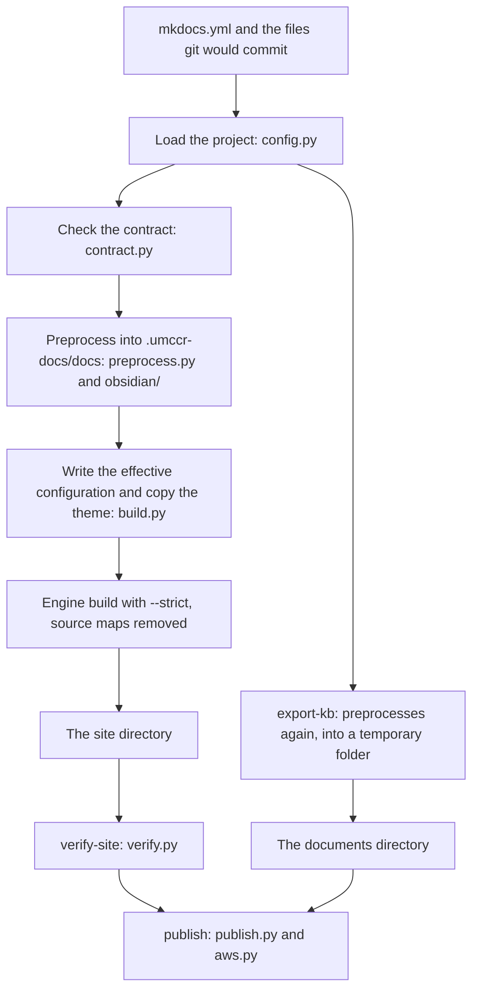

# Structure

How docs-toolkit is laid out, what a build reads and writes, where the toolkit runs, and the resources it uses. The
toolkit owns no infrastructure: docs-platform and OrcaSonar create every bucket, role and parameter it touches. What it
is for is in [Product](product.md), and what it is built with in [Tech stack](tech.md).

## Repository layout

```text
docs-toolkit/
├── src/umccr_docs/            # the package
│   ├── obsidian/              # the Obsidian adapter
│   └── theme/                 # Material template overrides, umccr.css, umccr.js and a copy of Mermaid
├── requirements/              # hash-pinned: build.txt (engine), dev.txt (pytest, ruff), zensical.txt (comparison)
├── templates/                 # the mkdocs.yml a new site starts from: plain Markdown, or an Obsidian vault
├── examples/                  # basic-site/ and obsidian-vault/, synthetic sites CI builds strictly
├── tests/                     # pytest, and tests/js/ for the theme's script
├── docs/, mkdocs.yml          # these pages and their site configuration
├── .github/workflows/         # ci.yml and release.yml
├── pyproject.toml             # the package, its version, the umccr-docs command, ruff's settings
└── Makefile, .pre-commit-config.yaml, CHANGELOG.md, CONTRIBUTING.md, SECURITY.md, LICENSE
```

The version is in both `pyproject.toml` and `src/umccr_docs/__init__.py`, which a test keeps equal. `CHANGELOG.md`
holds each release's notes under `## vX.Y.Z`.

## Modules

| Module | Does |
| --- | --- |
| `cli.py` | the `umccr-docs` command and its subcommands |
| `config.py` | reads `mkdocs.yml` as plain YAML, and the settings under `extra.platform` (`load_project`) |
| `contract.py` | the contract (`check_project`, `ALLOWED_KEYS`, `ALLOWED_PLUGINS`) |
| `active_content.py` | finds markup that could run code, read as a browser would (`unsafe_html`) |
| `files.py` | the files git would commit under `docs_dir`, and the pages the engine publishes |
| `markdown.py` | code-aware Markdown helpers, so no rewriting touches code |
| `preprocess.py` | copies `docs_dir` into the work directory, rewriting links and running the Obsidian adapter |
| `obsidian/` | `vault.py` resolves wikilinks; `links.py`, `callouts.py`, `properties.py`, `bases.py` and `tasks.py` convert the syntax |
| `build.py` | the effective configuration and the engine run (`build`, `serve`, `MARKDOWN_EXTENSIONS`, `THEME_FILES`) |
| `verify.py` | the pre-publish checks (`verify_site`) |
| `export_kb.py` | the documents for OrcaSonar (`export_kb`, `doc_id`) |
| `publish.py`, `aws.py` | uploads in a safe order, and the publisher's session, narrowed to one site |
| `media_types.py` | each file's `Content-Type`, and which types a browser opens as documents that could run code |
| `slug.py`, `errors.py` | the slug rules and the docs.umccr.org origin; `DocsError`, which the CLI prints without a traceback |

## The theme

`src/umccr_docs/theme/`, which the build copies into the work directory as Material's `custom_dir`:

| File | Does |
| --- | --- |
| `partials/content.html` | the page's title, the line under it with the `updated:` date and a GitHub link to the file, and the previous and next pages |
| `partials/copyright.html` | the footer: the source repository, the commit and the build time |
| `partials/logo.html`, `partials/path.html` | the UMCCR Docs logo, linking to `/platform/`, and the breadcrumbs |
| `assets/umccr/umccr.css` | the stylesheet, about 2,800 lines |
| `assets/umccr/umccr.js` | the one script, about 1,840 lines of plain JavaScript |
| `assets/umccr/mermaid/` | Mermaid `11.17.2`, byte for byte as npm ships it, with its MIT licence |
| `assets/umccr/logo.svg` | the logo and favicon |

`verify-site` refuses a site without the logo, the stylesheet, the script or Mermaid. The script has five parts:

| Part | Does | Calls |
| --- | --- | --- |
| Account menu | shows who is signed in, for display only | the Amplify ID token in `localStorage`; `/_auth/signout` |
| Catalogue | fills the platform's front page with site cards and a question box | `/_platform/data/catalog.json` |
| Search | adds rows to ask the docs, or search every site, to the search results | the chat panel |
| Chat panel | Ask and Search through OrcaSonar; ⌘K or Ctrl+K | `/_auth/env.js`, `/_auth/token.js`; OrcaSonar's `/chat`, `/search` and `/feedback` |
| Diagrams | draws Mermaid in strict mode, and refuses a drawing that holds script | `assets/umccr/mermaid/mermaid.min.js` |

The panel builds answers into page elements itself, and never parses what OrcaSonar returns as HTML.

docs-platform's Content Security Policy lets pages load scripts, styles, fonts and images only from docs.umccr.org, and
connect only to it, OrcaSonar and Cognito. Hence the system fonts, the bundled Mermaid, and no images from other sites.
The policy allows inline scripts, which Material needs, so it is the toolkit's checks that keep scripts out of pages.

## From source to published site



- **Inputs:** `mkdocs.yml`, and the files under `docs_dir` that git would commit, without dotfiles. The footer names
  `UMCCR_DOCS_SOURCE_REPO` and `UMCCR_DOCS_COMMIT`, or else `repo_name` and `git rev-parse HEAD`.
- **Work directory:** `.umccr-docs/` beside `mkdocs.yml`, with `docs/` (preprocessed), `theme/`, `mkdocs.yml`
  (effective) and `site/`, which the build then moves to `--site-dir`.
- **Built site:** `index.html`, `404.html`, a `<page>/index.html` for each page, Material's hashed assets, the theme
  under `assets/umccr/`, the search index and the sitemap.
- **Documents:** a `<path>.md` and a `<path>.md.metadata.json` per published page, under `kb/`. `export-kb`
  preprocesses on its own, strictly, so the documents always match the pages.

The metadata for the basic example's Getting started page:

```json
{
  "metadataAttributes": {
    "doc_id": { "value": { "type": "STRING", "stringValue": "example-basic:guide/getting-started" } },
    "site": { "value": { "type": "STRING", "stringValue": "example-basic" } },
    "title": { "value": { "type": "STRING", "stringValue": "Getting started" } },
    "url": { "value": { "type": "STRING", "stringValue": "https://docs.umccr.org/example-basic/guide/getting-started/" } },
    "commit": { "value": { "type": "STRING", "stringValue": "0123abcd" } },
    "updated": { "value": { "type": "STRING", "stringValue": "2026-11-19" } }
  }
}
```

`doc_id` is `<slug>:<path without .md>` and survives edits, so OrcaSonar's citations keep working. `site` is what
"This site only" filters on, and `updated` is the day of the export.

## What publishing writes

| Key | When | `Cache-Control` |
| --- | --- | --- |
| `docs/<slug>/...` in OrcaSonar's ingest bucket | first, with `--documents` | not set |
| `sites/<slug>/<file>` in the docs bucket | every file, before any deletion | `public, max-age=31536000, immutable` for `*.<hash>.min.js` and `*.<hash>.min.css`; `no-cache` for the rest |
| `sites/<slug>/_publish.json` in the docs bucket | last, after stale files are deleted | `no-cache` |

The marker, as the site pipeline writes it:

```json
{ "slug": "platform", "published": "2026-11-18T03:12:45+00:00", "files": 118, "deleted": 2, "release": 57,
  "repository": "umccr/docs-platform", "commit": "<commit>", "run_id": "<CodeBuild build ID>", "stage": "beta" }
```

## Where it runs

| Where | Runs | Access |
| --- | --- | --- |
| A developer's machine | `make` targets, and `umccr-docs serve` on any site | none, except a stage's admin credentials for a hand publish |
| docs-toolkit's CI | tests, lint, strict builds of the examples, the checks, with the package from its wheel | read-only |
| docs-toolkit's release workflow | the GitHub release for each `v*` tag | `contents: write` |
| docs-platform's CI | a strict build of `/platform/` with the latest release | read-only |
| The site pipeline's Build, CodeBuild in the toolchain account | `check`, `build`, `verify-site`, `export-kb` | none beyond its artifacts |
| The site pipeline's publish steps, beta then prod | `publish` | `docs-sites-publish`, which may only assume `docs-publisher` |

## AWS resources

| Resource | Created by | Used for |
| --- | --- | --- |
| The docs content bucket, and SSM `/docs/content-bucket-name` | docs-platform's `UMCCR-DocsHostingStack`, in each stage | the site under `sites/<slug>/`, and its marker |
| OrcaSonar's ingest bucket and KMS key, and SSM `/orcasonar/ingest-bucket-name` | `UMCCR-OrcaSonarStatefulStack`, where OrcaSonar runs | the documents under `docs/<slug>/`; skipped with a warning when the parameter is missing |
| The `docs-publisher` role, path `/docs/` | docs-platform's hosting stack, in each stage | assumed by `publish --role-arn` |
| The `docs-sites-publish` role | docs-platform's `DocsInfrastructurePipeline`, in the toolchain account | the publish steps |

`publish` assumes `docs-publisher` for an hour as `docs-publish-<slug>`, which CloudTrail records, and reads the bucket
names from SSM. Its session policy, here for the slug `platform`, caps what the publish can do; AWS grants only what
both this policy and the role allow:

```json
{
  "Version": "2012-10-17",
  "Statement": [
    { "Effect": "Allow", "Action": "s3:ListBucket", "Resource": "*",
      "Condition": { "StringLike": { "s3:prefix": ["sites/platform/*", "docs/platform/*"] } } },
    { "Effect": "Allow", "Action": ["s3:GetObject", "s3:PutObject", "s3:DeleteObject"],
      "Resource": ["arn:aws:s3:::*/sites/platform/*", "arn:aws:s3:::*/docs/platform/*"] },
    { "Effect": "Allow", "Action": "ssm:GetParameter", "Resource": "*" },
    { "Effect": "Allow", "Action": ["kms:GenerateDataKey", "kms:Decrypt"], "Resource": "*",
      "Condition": { "StringLike": { "kms:ViaService": "s3.*.amazonaws.com" } } }
  ]
}
```

## GitHub resources

| Resource | Use |
| --- | --- |
| `.github/workflows/ci.yml` | four jobs on every pull request and push to `main` ([Tests and CI](tech.md#tests-and-ci)) |
| `.github/workflows/release.yml` | the GitHub release for each `v*` tag ([The tag system](runbook.md#the-tag-system)) |
| Tags and releases | tags `v0.2.0` to `v0.3.2`; only `v0.3.2` has a GitHub release on 2026-11-19 |
| `https://github.com/umccr/docs-toolkit/releases/latest` | redirects to the latest release, which docs-platform reads to resolve `latest` |
| Rulesets | `protect-main` on `main`; none on tags yet ([Repository settings](runbook.md#repository-settings)) |

## How docs-platform runs the toolkit

From `infrastructure/toolchain/sites-pipeline.ts` in docs-platform. Each step first refuses a `TOOLKIT_REF` that is not
a release tag or a full commit, then installs it with Python 3.12:

```sh
git clone --quiet https://github.com/umccr/docs-toolkit.git "$TOOLKIT_DIR"
git -C "$TOOLKIT_DIR" checkout --quiet "$TOOLKIT_REF"
python -m pip install --quiet --require-hashes --no-deps -r "$TOOLKIT_DIR/requirements/build.txt"
python -m pip install --quiet --no-deps "$TOOLKIT_DIR"
umccr-docs --version
```

Build runs the first four commands, and each publish step the last:

```sh
umccr-docs check --slug "$SLUG" --config "$CONFIG_PATH"
UMCCR_DOCS_SOURCE_REPO="$REPO" UMCCR_DOCS_COMMIT="$COMMIT" umccr-docs build --slug "$SLUG" --config "$CONFIG_PATH" --site-dir out/site
umccr-docs verify-site out/site
umccr-docs export-kb --slug "$SLUG" --config "$CONFIG_PATH" --commit "$COMMIT" --out out/kb
umccr-docs publish site --slug "$SLUG" --role-arn "$PUBLISHER_ROLE_ARN" --release "$RELEASE" --documents kb
```

These commands, their options and the `UMCCR_DOCS_*` variables are an interface between the two repositories
([Change these together](tech.md#change-these-together)).
